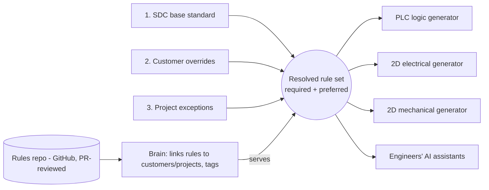

# Customer Project Engineering Standards → AI Rules (Nov 2026)

A plan, not rule content. It came from the retired `SDC-Brain` repository
([ADR 0006](adr/0006-share-inventory-under-tools.md)). Where the rule files
themselves live is still open; it is not this repo. "Brain" below means the
warehouse and its catalog (`tools/data-warehouse/ROADMAP.md`).

## Summary

Before SDC automates PLC logic, 2D electrical drawings or 2D mechanical drawings, codify the standards
those deliverables follow as rules an AI reads on every request. The roadmap names all three automation
efforts but defines none of the standards behind them.

Plan: one rule set per discipline, layered **SDC base → customer overrides → project exceptions**, each rule
marked required or preferred. AI drafts rules from completed SDC projects and customer specs; engineering
reviews; rules are versioned in GitHub and linked to customers/projects in Brain. Every generator and every
engineer's AI assistant pulls the same resolved rule set for the job.

Origin: Rockwell Automation Fair session "Make your AI Assistant work your way" — codify standards → rules.

## Where things stand today

From the SDC Pipelines page (v3, 2026-11-18), which draws on the November 2026
PLC, 2D drawing and EE meetings. Not checked against the tools themselves.

| Discipline | What exists | Where its rules are kept | Who approves |
| --- | --- | --- | --- |
| PLC logic | A Claude-based code generator in daily use on one job, building station programs from SDC templates | "Lessons" learned from engineers' corrections, in a Git repo under a personal account | Controls lead |
| 2D mechanical | A rule-based drawing generator for SolidWorks (no AI at run time), and an SDC design plugin for Claude | Rules in the generator's code and in the plugin; the generator's source sits in a job folder | ME lead |
| 2D electrical | Automatic schematic generation in progress; a read-only EPLAN MCP prototype | Not known | Not known |

So standards are already being captured, but separately per discipline, in
three different places, with no customer or project layer. This plan is the
common shape for them.

## Rule hierarchy

Later layers override earlier ones only where they differ. Review corrections flow back as rule changes.

## What to codify (starting checklist — confirm against SDC practice)

| Discipline | Naming | Structure | Patterns |
| --- | --- | --- | --- |
| PLC logic | Tags, UDTs, AOIs, routines; I/O and alarms; comments | Program/task layout; routine order; station/module breakdown; HMI screen hierarchy | Standard AOIs for motion, valves, conveyors, safety, faults/alarms; state machine + modes; HMI faceplates |
| 2D electrical | Device tags, wire numbers, terminals, cables, sheets | Set order (cover, power, control, I/O, panel, BOM); title block; cross-references | Standard circuits; symbol library; panel layout rules |
| 2D mechanical | Part/drawing numbers, revisions, file names | Sheet/view order; title block; BOM + balloons | GD&T defaults; standard notes; purchased-part callouts; weldment/assembly conventions |

Each rule records: rule text, required|preferred, source (SDC or customer), example from a real SDC project,
last-reviewed date. Where a customer cites a published standard (e.g. NFPA 79, ASME Y14.5), record the clause required.

## How rules reach generation and Brain

- Plain-text rule files (Markdown/YAML) in the private GitHub repo; folder per discipline; base set + one override file per customer; PR approval by an engineering lead.
- Brain indexes rule files; links customer overrides → customer record, project exceptions → project record; tags by discipline, customer, required/preferred.
- Generators request the resolved set (base + customer + project) before generating; AI assistants get it as standing instructions.
- AI reads rules/templates; it does not edit proprietary design files.
- Reviewer corrections are checked against rules; missing/wrong rules become rule changes.

## Pilot

1. Pick 2–3 recent projects (different customers) with complete PLC programs, electrical sets, mechanical drawings and any customer specs.
2. AI drafts rule lists per discipline from those files, citing an example per rule.
3. Compare: rules common to all → SDC base; differing by customer → overrides.
4. Review with one lead per discipline: required / preferred / dropped.
5. Commit to repo; load into Brain linked to pilot customers/projects.
6. Generate one small deliverable per discipline with and without rules; lead compares.

## Next steps

- Rule file schema (YAML): id, discipline, category (naming, structure,
  pattern), rule text, level (required, preferred), source (SDC or a customer),
  example reference, last reviewed, supersedes.
- A resolver that merges base → customer → project, with tests for override
  precedence.
- A shortlist of pilot material found by metadata only, from
  `tools/share-inventory`. No file is opened until a person clears it.
- Needs a person: pick 2–3 pilot projects, name a rules owner per discipline,
  and decide where the rule files live. Moving the PLC lessons repo into the
  SDC organization is already on the Pipelines page.

## Open questions

1. Which PLC platforms and CAD tools does SDC deliver in; do customers dictate them?
2. Do customers supply written engineering specs, and how often?
3. Does SDC have any written house standard today?
4. Who are the electrical/mechanical automation teams; do their tools already encode conventions?
5. Who approves rule changes: discipline lead, chief engineer, or both?
6. Check finished deliverables against rules automatically, or only guide generation at first?
